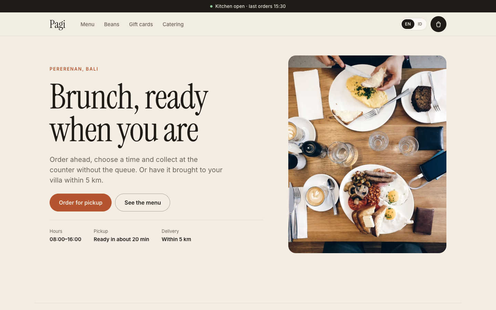
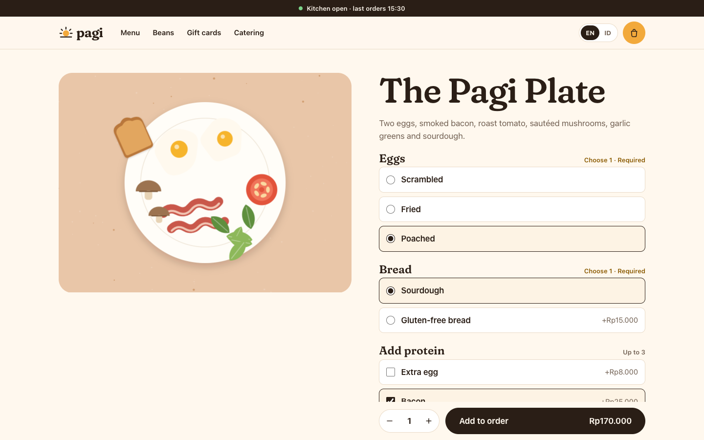
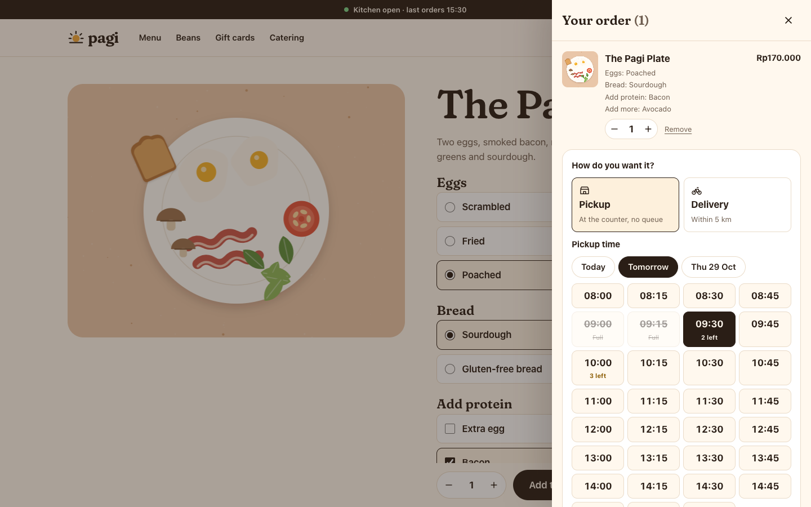
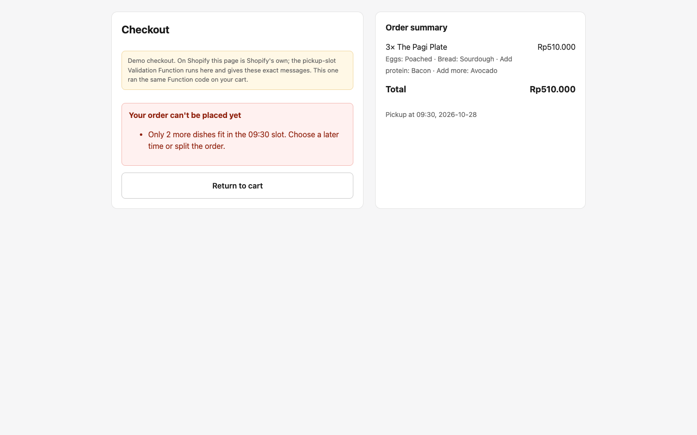
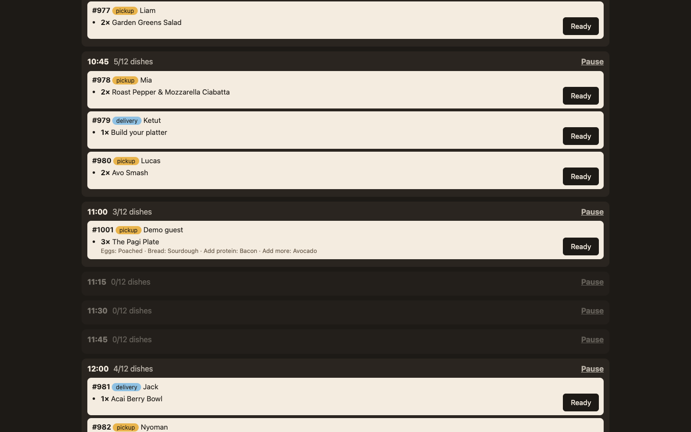
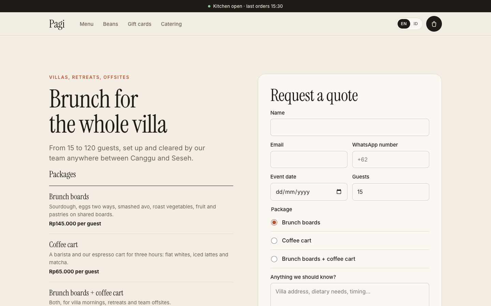
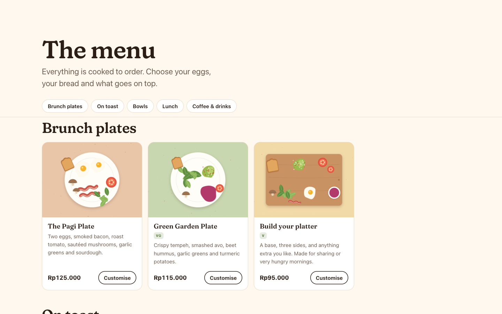
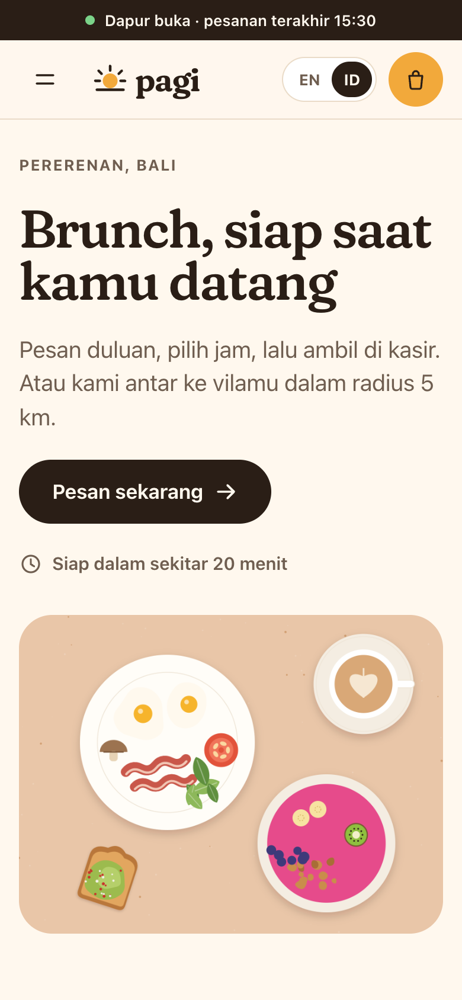
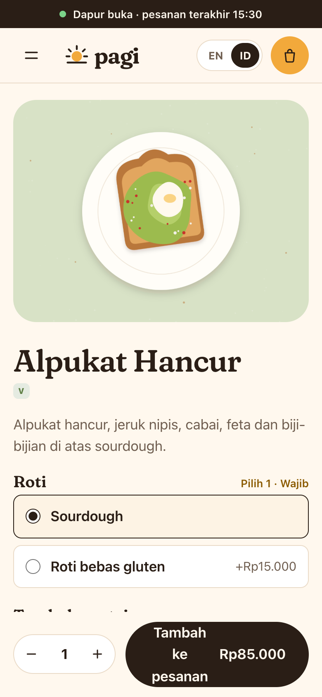
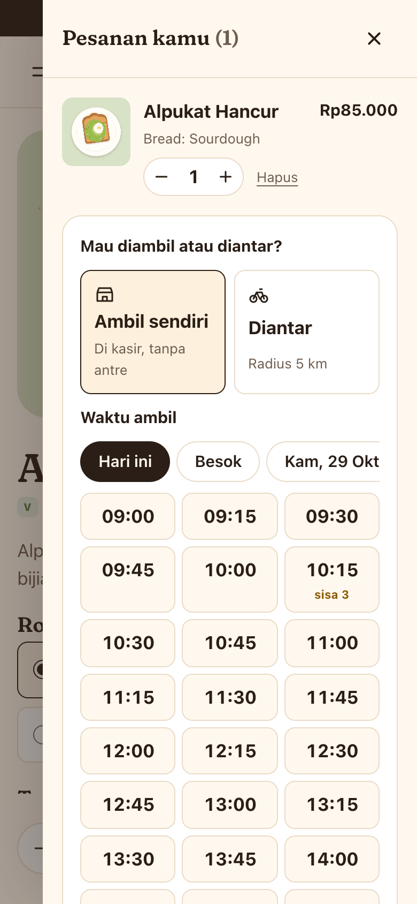

# Pagi — Shopify store build

A Shopify build for **Pagi**, a fictional brunch café in Bali that wants its own online ordering instead of paying a delivery app's commission. Customers build a dish with add-ons, choose **pickup or delivery and a time**, and pay through Shopify. Checkout refuses times the kitchen can't cook for. Orders land on a **kitchen board**, and larger groups request **catering quotes**. The store runs in English and Bahasa Indonesia.

**▶ 87-second demo: [geffaa.github.io/pagi-shopify](https://geffaa.github.io/pagi-shopify/)**

**🍳 Order from the demo café: [geffaa.github.io/pagi-shopify/store/](https://geffaa.github.io/pagi-shopify/store/)**. The real theme, both Functions and the kitchen board run in your browser. Place an order, then open the kitchen board from the thank-you page.

**🎨 UI & design system in Figma: [figma.com/design/…/Pagi](https://www.figma.com/design/K2hh5dzxNxiLj9Z8kR1SqY/Pagi)**. Tokens, components and the key screens, built from the same values as the theme.

[](https://geffaa.github.io/pagi-shopify/)

| | What | Stack |
|---|---|---|
| [`theme/`](theme) | Custom Online Store 2.0 theme, EN and ID | Liquid, CSS, vanilla JS (Web Components) |
| [`extensions/menu-addons/`](extensions/menu-addons) | Prices add-ons into the dish line | Cart Transform Function (`lineExpand`) |
| [`extensions/pickup-slot/`](extensions/pickup-slot) | Refuses bad times at checkout | Cart & Checkout Validation Function |
| [`lib/`](lib) | Add-on rules and slot maths, shared by both Functions, the backend and the preview | Plain JavaScript |
| [`ops/`](ops) | Webhooks, slot capacity, kitchen board, catering | Node, Hono, `node:sqlite` |
| [`scripts/`](scripts) | Seeds a dev store: menu, add-ons, beans, gift card, translations, both Functions | Admin GraphQL API |
| [`design/`](design) | Crops and colour-grades the public-domain food photos into one consistent set; draws the gift card | Headless Chrome |
| [`preview/`](preview) | Renders the theme offline, runs the Functions on the preview cart, end-to-end checks | liquidjs, Puppeteer |

---

## How an order flows

```
dish page ── add-on variant IDs in line property _mods ──▶ Cart Transform: dish + add-ons, priced
cart drawer ── GET /apps/pagi/slots (app proxy) ──▶ pagi-ops: what each slot has left
            ── cart attributes fulfilment, pickup_slot
checkout ──▶ Checkout Validation: hours, lead time, capacity, valid add-ons
orders/create webhook ──▶ pagi-ops: count dishes per slot, tag the order, update the board
                      ──▶ shop metafield pagi.slot_state, which the Validation reads
```

### 1. Dishes with add-ons → Cart Transform Function
[`sections/main-product.liquid`](theme/sections/main-product.liquid), [`assets/dish.js`](theme/assets/dish.js), [`extensions/menu-addons`](extensions/menu-addons).

- **Choice groups come from a metafield** (`pagi.modifiers`, JSON) written by the seed script: eggs (choose 1), bread (sourdough, or gluten-free for Rp15.000), protein (up to 3), the benedict style, the pancake topping, and so on. The page enforces each group's minimum and maximum and shows the running total.
- **Free choices** become line properties named after the group (`Eggs: Poached`), so they print on the kitchen ticket and the receipt. They stay in English so the kitchen reads one language.
- **Paid add-ons are hidden products.** Their variant IDs go into the private property `_mods`. The **Cart Transform** expands the dish line into the dish plus its add-ons, so the price is Shopify's, not the theme's, and add-on sales show in reports.
- An add-on the dish doesn't offer, or too many from one group, is left unexpanded by the Transform and refused by the Validation. Both use the same rules in [`lib/modifiers.js`](lib/modifiers.js).

| | |
|---|---|
|  |  |

### 2. Pickup and delivery times → Checkout Validation Function
[`snippets/fulfilment.liquid`](theme/snippets/fulfilment.liquid), the slot picker in [`assets/global.js`](theme/assets/global.js), [`extensions/pickup-slot`](extensions/pickup-slot), [`lib/slots.js`](lib/slots.js).

- **Slots are 15 minutes** from 08:00 to last food orders at 15:30, up to two days ahead, at least 20 minutes from now. **Capacity is counted in dishes** (12 per slot), because that's the kitchen's real limit; a coffee-only order and a table of six are not the same load.
- The drawer loads live availability from `/apps/pagi/slots` (app proxy → `pagi-ops`), disables full slots and flags the ones nearly full. The choice is saved as cart attributes. Checkout stays disabled until a time is chosen, unless the cart only has beans or a gift card.
- **The Validation decides.** Functions can't read the clock or call a server, so `pagi-ops` publishes a shop metafield `pagi.slot_state` (`{ closed: [...], used: { slot: dishes } }`) whenever an order arrives and every minute. The Function checks the slot against it, plus the hours in its own configuration metafield and the shop's local date. Messages are specific: *"Only 2 more dishes fit in the 09:30 slot. Choose a later time or split the order."*



### 3. Kitchen board and catering → `pagi-ops`
[`ops/src`](ops/src).

- **Webhooks** (`orders/create`, `orders/cancelled`, app and privacy topics) are HMAC-checked, de-duplicated by webhook id, acknowledged at once and processed in a retrying queue. A cancelled order frees its dishes in the slot.
- **Kitchen board** (`/kitchen`, password-protected): today's orders grouped by slot with every choice and note, marked ready and collected; any slot can be paused, which closes it at checkout within seconds. Orders are also tagged `slot:2026-10-27T09:15` and `pickup`/`delivery` in Shopify admin.
- **Catering** (`/pages/catering`): the form posts to `/apps/pagi/catering`, which checks the request and creates a **draft order** tagged with the event date. The team adjusts it and sends the invoice from Shopify admin, so catering revenue sits in the same reports and payouts as online orders.

| | |
|---|---|
|  |  |

---

## Design

A photo-led menu in the layout people know from delivery apps: name, description and price on the left, a square photo on the right, sticky category tabs. Sand background, near-black ink and one terracotta accent; Instrument Serif for headings and dish names, Inter for prices, times and buttons. Both fonts are self-hosted with metric-matched fallbacks so the page doesn't shift when they load.

| | |
|---|---|
|  |  |

## UI & design system (Figma)

The interface is also documented as a Figma file: **[Pagi on Figma](https://www.figma.com/design/K2hh5dzxNxiLj9Z8kR1SqY/Pagi)** (view only).

| Page | What's in it |
|---|---|
| Cover & Foundations | Case-study cover; 26 variables (colour, spacing, radius) whose code syntax matches the theme's CSS custom properties (`var(--paper)`, `var(--accent)`, `var(--r-md)`…); 11 text styles; colour swatches with their WCAG contrast on the page background |
| Components | Button, Chip, Time slot (available / low stock / full / selected), Badge, Pickup–Delivery option, Quantity stepper, Add-on option (radio / checkbox), Menu row, Cart line, Kitchen ticket (new / cooking / ready), all bound to the variables |
| Screens | Mobile flow: menu → dish with add-ons → cart and pickup time → confirmation, plus the cart in Bahasa Indonesia; the kitchen board on a tablet; the desktop menu |

Because the variables carry the same names as the theme's CSS, a change of colour or radius is a single edit in each place, and the Figma file can't drift from what ships.

## Bahasa Indonesia

The `id` locale is enabled and published by the seed script, and every product, add-on and collection gets an Indonesian title and description through `translationsRegister`. Theme strings live in [`locales/id.json`](theme/locales/id.json); section copy is translated in Shopify's Translate & Adapt (the preview emulates that with [`preview/content.id.json`](preview/content.id.json)). Prices are in rupiah and include PB1 tax, as Bali menus do.

<p>
  
  
  
</p>

---

## Quality

| Check | Result |
|---|---|
| Shopify Theme Check | 0 offenses |
| Function tests | 18: add-on expansion and rejection, missing or malformed slots, past days, hours, the 15-minute grid, closed and full slots, capacity left, configuration from the metafield, broken metafields |
| Backend tests | 10: HMAC, idempotent orders, capacity published once, cancellation frees a slot, time passing closes slots, signed app proxy, catering → draft order, kitchen board, pausing, privacy redaction |
| Slot and seed tests | 11: Bali time whatever the server clock, lead time across midnight, catalog consistency, every image the theme names exists, the Validation reading the seeded configuration |
| End-to-end ([`preview/e2e.mjs`](preview/e2e.mjs)) | 12/12, against both the Node preview and the in-browser demo: add-ons and limits, required groups, Cart Transform pricing, slot picker, checkout refusals, placed order on the board, beans-only checkout, catering, language switch, no JS errors |

## Trade-offs

- **Capacity is checked at checkout, not reserved.** Two customers can take the last dishes in a slot within the same minute. The board flags any slot that goes over capacity and the kitchen decides; reserving seats would need a hold-and-expire step that Shopify checkout doesn't offer to themes.
- **Pickup-scheduling apps exist** and cover dates and hours. This build is for the case where the limit is dishes per slot and add-ons must be priced, which those apps don't combine.
- **To verify on a development store before launch:** that `lineExpand` accepts the dish's own variant as a component (the Transform expands each dish into itself plus add-ons), how expanded lines appear in order webhooks (`pagi-ops` counts dishes by `MENU-` SKUs to be safe either way), and the exact wording of Validation messages in checkout. Delivery fees come from Shopify's local delivery settings, not this code.

## The live store demo

`docs/store/` is the offline preview running in the visitor's browser. `npm run web` bundles `preview/server.mjs` into a Service Worker with esbuild, with Node's `fs`, `http` and `path` swapped for small shims and the theme embedded. Besides the storefront, the worker runs the real Cart Transform on the cart, answers `/apps/pagi/*` with the backend's own code, stands in for checkout by running the real Validation, and renders the kitchen board from `ops/src/kitchen.js`. State-changing requests are replayed when the browser restarts an idle worker, so the cart and placed orders survive.

```bash
npm run web
WARMUP=1 BASE=http://localhost:8000/pagi-shopify/store npm run e2e   # with docs/ served at /pagi-shopify/
```

## Running it

```bash
npm install && npm --prefix ops install

npm run preview      # offline preview at http://localhost:9595 (PREVIEW_NOW=2026-10-27T09:05 pins the clock)
npm run e2e          # 12 end-to-end checks against the preview
npm test             # Functions, shared libs, seed and backend tests
npm run theme:check

# On a development store
shopify app deploy                         # both Functions + app proxy (fill client_id and URLs in shopify.app.toml)
cp .env.example .env && npm run seed       # menu, add-ons, translations, Cart Transform, Validation
cp ops/.env.example ops/.env && npm --prefix ops start
npm run theme:dev
```

In the store admin, set the currency to IDR with taxes included in prices, and turn on local pickup and local delivery (5 km) for the café's location.

Pagi is a fictional café made for this portfolio. The food photos are public domain (CC0) from rawpixel and StockSnap, found through Openverse and listed in [`design/photos/CREDITS.md`](design/photos/CREDITS.md); [`design/build.mjs`](design/build.mjs) crops them to one shape and gives them one shared colour grade so they read as a single shoot.
